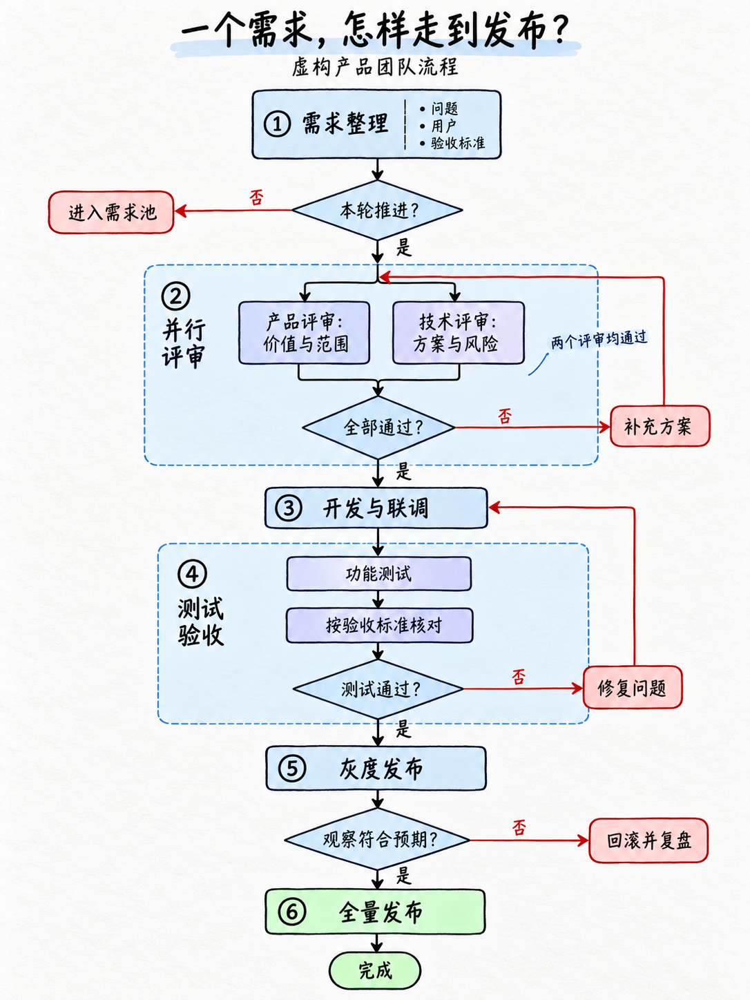

# Hand-Drawn Flow

将文字或上传文件转成清晰、有手绘质感的流程图。根据内容选择顺序主线、角色泳道、条件分支或模块展开，支持辅助插图与三种画幅比例，并核对来源、文字和连接关系。

将文字或上传材料整理成清楚、准确、有手绘质感的流程与关系图。以用户初始参考的编号主线、模块内展开、功能色和邻近旁注为基准。交付生成式位图，支持3:4、16:9、1:1。

## 当前版本

2026-10-17，v0.3.0-rc.3。按用户确认的方向统一为一种手绘流程图风格。插图可选无插图或少量辅助插图；布局根据步骤、角色交接、条件分支和内部机制选择，不再把画法差异包装成三个风格。此前六种插画门类不再是当前预设，历史图片保留作探索记录。

## 使用

将完整 `hand-drawn-flow` 文件夹放入宿主 Skill 目录，保留 agents 和 references。本项目没有自动全局安装。

> 使用 $hand-drawn-flow，把这份需求文档做成3:4手绘流程图，保留条件分支、并行审核和异常出口，复杂步骤在模块内展开。

> 把这份系统设计做成16:9手绘泳道图，区分角色、请求方向和旁注。

> 将这本书第三章的方法整理成1:1手绘流程图，加入少量辅助插图，小图只用于解释关键对象，不添加原文没有的步骤。

> 将这些故事卡整理成事件时间线，按材料中的时间证据排序，不补写情节。

材料充分时直接处理；歧义影响事实或范围才询问。没有流程的内容按层级或关系表达，不硬造因果，也不自动画海报或绘本。

## 读取与生成

文件路由涵盖TXT/MD、DOCX、PDF、EPUB、图片及演示/表格；实际可读性取决于宿主工具。保留已读范围、来源位置和未读缺口，不把提取成功当作内容验证通过。

正常出图需要宿主生图与看图能力，不要求额外Key或自动安装服务。默认一次生成加一次有针对性的修正；比例须核对实际尺寸，不能将近似16:9称作精确。局部编辑后仍检查整图。

## 验证状态

本轮统一风格与布局路由，完成文本审查、结构、相对链接和发行包校验，见[验证记录](validation/v0.3-rc3/REPORT.md)。后续已完成步骤/泳道对照和复杂流程样例，范围与发现见下方记录；不代表所有布局均已验证。此前[三张同题样例](validation/three-flow-styles-2026-10-17/REPORT.md)构图过于相似，作为调整依据保留，不再视作三个独立风格。

历史文件测试见[材料读取记录](validation/v0.3/SOURCE-REVIEW.md)：合成DOCX正文/表格、PDF、短篇EPUB和PNG故事卡已读取；DOCX页面渲染受LibreOffice缺失影响。PPTX/XLSX、真实长书、模糊扫描等未实测。

历史六风格探索见[样图报告](validation/six-styles-v03-2026-10-17/REPORT.md)，不作为当前合格锚点。未做直接生图基线对比或真实手机验证。

- [Skill入口](hand-drawn-flow/SKILL.md)
- [统一风格与插图设置](hand-drawn-flow/references/styles.md)
- [原v0.2验证](validation/v0.2/REPORT.md)
- 候选包：`dist/hand-drawn-flow-v0.3.0-rc.3.zip`

## 最新样例

- [步骤总览与角色泳道对照](validation/layout-routing-2026-10-17/REPORT.md)
- [需求到发布：并行评审与返工](validation/complex-flow-2026-10-17/REPORT.md)
- [内容协作、知识问答、活动筹备](validation/more-complex-2026-10-17/REPORT.md)

## 源码与候选包

Skill源文件在 `hand-drawn-flow/`。本仓库不自动发布GitHub Release；dist为本地构建产物，未纳入Git。维护者可运行 `python -X utf8 validation/v0.3-rc3/check_package.py` 校验并构建，需要Python、PyYAML、Git以及本地Codex的skill-creator校验脚本。历史版本脚本保留当时名称与环境，不作为当前构建入口。

旧标识为 `hand-drawn-explainer`，现统一为 `hand-drawn-flow`；安装或调用请使用新名称。
