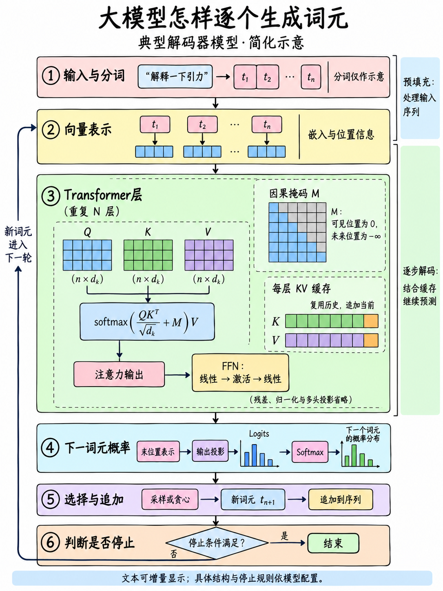
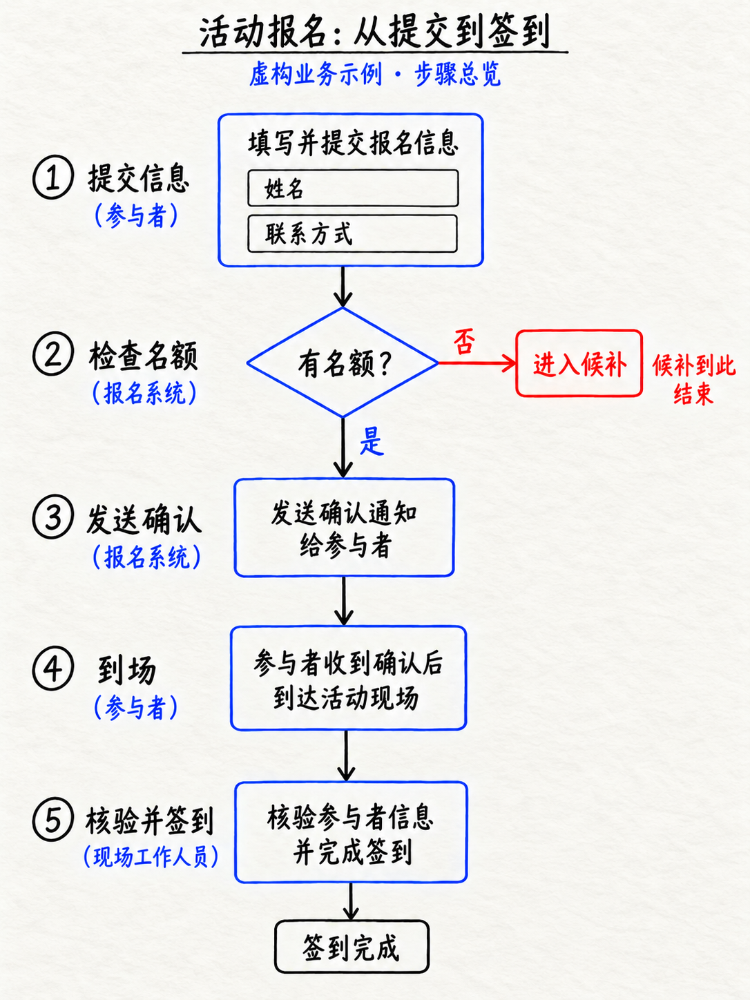
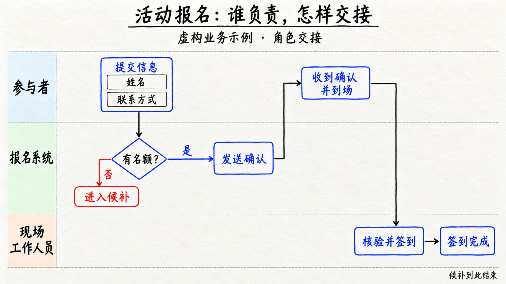
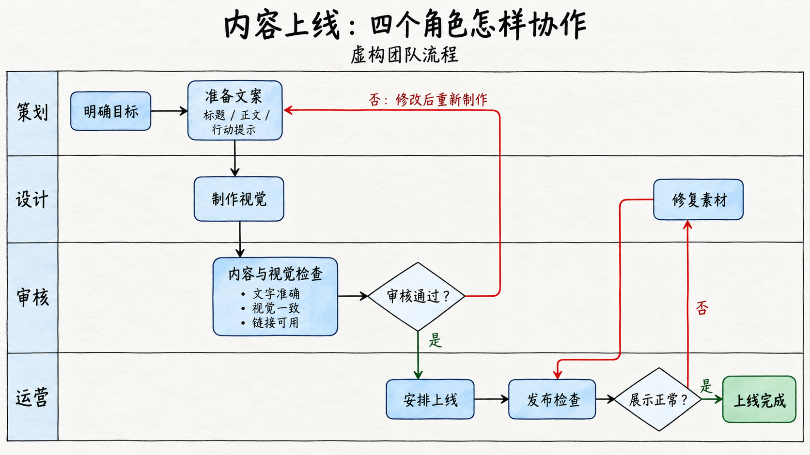
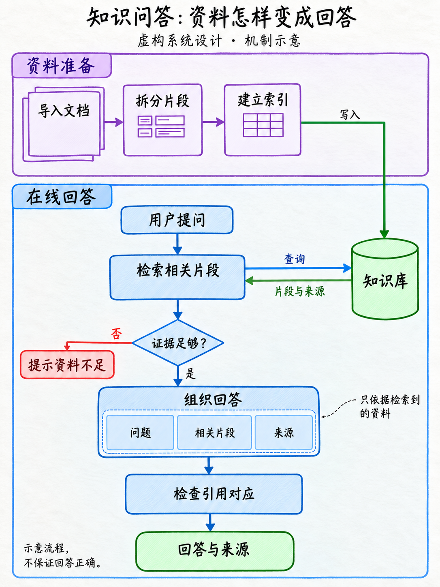
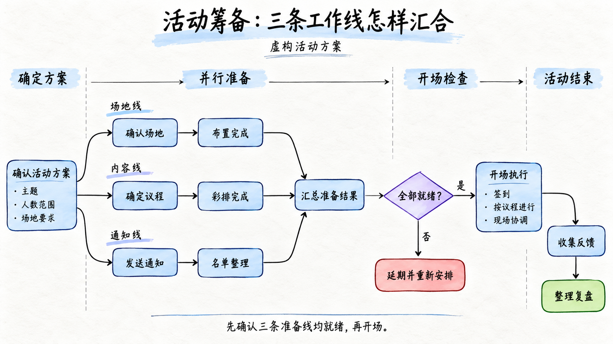

<div align="center">

# ✍️Hand-Drawn Flow

### 把文字与文件，变成讲得清楚的手绘流程图

[](validation/v0.4-rc1/REPORT.md)
[](hand-drawn-flow/SKILL.md)
[](#visual)

**主线讲清过程，局部展开难点，旁注保留条件。**

[快速开始](#start) · [样例预览](#examples) · [设计方法](#workflow) · [安装使用](#install) · [验证状态](#status)

</div>

输入一段说明、一份需求文档、设计资料或书籍章节，Hand-Drawn Flow会先梳理内容关系，再选择构图，调用宿主的生图工具生成手绘流程图。

保留参考图式的浅纸面、细线连接、功能色与手写感。复杂内容通过分支、泳道、回路和局部展开表达，让图里的每条连线都有依据。

## 🎯适合用在哪些场景

|你手上的材料|想让读者看懂什么|图里重点表达|
|---|---|---|
|需求文档、业务说明|从开始到完成，要经过哪些环节|主流程、判断条件、异常出口|
|系统设计、技术资料|内部怎样处理，模块怎样配合|输入输出、模块展开、数据方向|
|多人协作、审批流程|谁负责，下一步交给谁|角色泳道、并行任务、返工回路|
|书籍章节、方法笔记|方法怎么用，哪些条件不能省|行动步骤、适用条件、全程原则|
|故事卡片、事件材料|发生了什么，人物与事件怎样关联|时间顺序、对象变化、关系结构|
|已有流程图、视觉参考|保留哪些内容，改进哪些表达|关系重建、布局调整、局部修改|

没有先后过程的材料，可以整理成层级或关系图；不会为了画流程图而编造因果。

<a id="start"></a>

## 🚀只需要说清楚你想画什么

安装后，上传材料并输入：

```text
使用$hand-drawn-flow，把这份需求文档做成16:9手绘流程图。
给第一次接触业务的同事看，保留判断条件和异常处理。
```

纯文字也可以直接使用：

```text
使用$hand-drawn-flow，画一张3:4手绘流程图：
用户提交申请→系统校验→人工审核→通知结果。
校验失败退回补充，审核不通过说明原因，允许修改后重新提交。
```

材料充分时直接制作；影响事实、范围或理解的关键信息缺失时，再做必要追问。无需先选模板、填写风格问卷或逐步审批。

<details>
<summary>💬更多用法：角色协作、书籍转图与修改图片</summary>

**突出职责与交接：**

```text
使用$hand-drawn-flow，把这份系统设计做成16:9手绘泳道图。
区分用户、业务系统与工作人员，标清动作归属和请求方向。
```

**聚焦书籍中的一个方法：**

```text
使用$hand-drawn-flow，把第三章的方法整理成1:1手绘流程图。
只覆盖该章，保留适用条件，必要时加入少量辅助插图。
```

**修改已有图片：**

```text
把“审核不通过”的回线改为返回“补充材料”。
保留其他节点、配色和布局，修改后检查整图连接。
```

也支持只分析参考图、只整理内容，或只输出绘图提示词；这些请求不会触发生图。

</details>

<a id="examples"></a>

## 🖼️样例预览

七张样例展示AI原理讲解、简单步骤与复杂协作：同一套手绘语言，按解释任务安排画面。

### AI原理讲解｜大模型怎样逐个生成词元

将因果自注意力、Q/K/V矩阵、掩码公式、KV缓存和词元生成循环展开在一张图里。主线讲过程，局部讲机制，旁注交代简化范围；适合技术科普、原理教学与学习笔记。



本图按v0.4设计流程新生成，实际尺寸1086×1448，比例3:4。已查看关键文字、公式与循环路径；它是简化机制图，省略残差、归一化及多头输出投影等细节，不代表完整模型架构。建议打开原图阅读公式。

[查看当前图片的提示词与填色检查](validation/clean-fill-2026-10-24/REPORT.md)｜[原版设计依据与检查记录](validation/ai-mechanism-2026-10-24/REPORT.md)

> 以下六张为v0.3时期基于虚构业务材料生成的历史样例，检查范围与已知问题见对应报告。历史图片与本次AI原理图均不代表所有场景已完成验证。

### ①顺序主线｜活动报名到签到

用纵向编号组织步骤，把“名额不足”作为独立出口，适合快速读懂完整过程。



### ②角色交接｜同一流程，换一个阅读角度

将同一份报名材料改成泳道图，突出参与者、报名系统和现场工作人员之间的职责与交接。



[查看两种布局的对照记录](validation/layout-routing-2026-10-17/REPORT.md)

### ③复杂分支与回路｜需求到发布

在同一张图中组织并行评审、条件判断、测试展开与返工路径。


[查看复杂流程检查记录](validation/complex-flow-2026-10-17/REPORT.md)

### ④多角色协作｜内容上线

用四角色泳道组织策划、设计、审核与运营，展示审核退回和发布前修复的路径。



### ⑤模块与数据交互｜资料怎样变成回答

区分资料准备与在线回答，标出知识库的写入、查询、返回方向，并保留证据不足的出口。



### ⑥并行分工与汇合｜活动筹备

场地、内容、通知三条工作线并行推进，汇合后检查是否就绪，再进入开场或延期分支。



[查看多角色、系统交互与并行阶段的检查记录](validation/more-complex-2026-10-17/REPORT.md)

横图为近似16:9；活动筹备图表达阶段关系，不是按比例的甘特图。系统交互图仍有旁注小箭头等已知细节问题，详见报告。

<a id="workflow"></a>

## 🧭从材料到图片，怎样设计

这个Skill把来源、内容关系、构图和检查规则串成一个工作流。重点是先解决“这张图要解释什么”，再决定怎么画。

|阶段|要解决的问题|具体动作|
|---|---|---|
|明确讲解目标|读者看完要理解什么|识别用途、核心问题与最易误解处|
|解构材料|哪些内容真的存在关联|记录来源，区分动作、状态、条件、原则、证据和目标|
|建立构图|怎样安排才能读得懂|选择主线、泳道或分支，安排阅读路径、连线通道和展开区域|
|细化表达|难点用什么方式讲清|表现对象变化、局部机制、角色交接，控制文字与旁注密度|
|生成图片|怎样保持统一视觉|结合内容、构图与表现要求调用宿主生图工具|
|检查交付|图中表达是否忠实、清晰|核对文字、连接、来源、实际比例和目标阅读尺寸|

**简单需求轻量处理，复杂需求保留设计稿。**短文直接整理后生成；长文件、多角色、并行回路等任务保留一份可复用设计稿。构图草案使用区域表或文字框图，不额外消耗生图次数。

**修改沿用同一份设计依据。**先判断改动涉及内容、构图还是表现，再更新相关部分并检查整图，避免修好一个箭头却改坏其他关系。

**交付前检查读者能否看懂。**复杂图先从图中复述关系，再对照材料核验；独立审查、自查和真人测试分别记录。默认一次生成加一次针对性修正，仍有关键错误或检查缺口时交付候选图并说明问题。

设计细节：[讲解策划与设计稿](hand-drawn-flow/references/explanation-design.md)｜[局部设计范例](hand-drawn-flow/references/visual-patterns.md)

<a id="visual"></a>

## 🎨统一手绘语言，按内容选择布局

浅纸面、清晰手写感、细线连接、功能色与邻近旁注构成统一视觉语言。步骤保持紧凑，难点留出展开空间，色彩服务于角色、状态和信息区分。

手绘感来自线条与字形，色块默认均匀浅色平涂；纸纹不进入填色。矩阵、缓存与节点底色须检查漏白和斑驳，有含义的空白则保留。历史AI样例暴露的填色问题已加入规则与验收，[修复记录](validation/clean-fill-2026-10-24/REPORT.md)区分规则修复与实际图片效果。

|读者想看什么|适合的布局|
|---|---|
|先做什么，接下来做什么|顺序主线|
|谁负责，怎样交接|角色泳道|
|不同条件走向哪里|条件分支|
|内部如何处理|模块内展开|
|有哪些包含或依赖|层级与关系图|

- **无插图：**以节点、文字和连线为主，保留有信息作用的数据或机制示意。
- **少量辅助插图：**在关键节点加入文件、设备等小型示意，帮助识别对象。
- **三种比例：**支持3:4、16:9、1:1；切换比例时重新安排布局，保留相同事实与关系。

未指定时按内容判断。当前采用一套视觉语言与两种插图程度，局部表达范例不作为额外风格菜单。

详细规则：[统一视觉语言](hand-drawn-flow/references/styles.md)｜[布局与比例](hand-drawn-flow/references/layout-and-ratios.md)

<a id="install"></a>

## 📦安装与运行

```bash
git clone https://github.com/Surge-Dan/hand-drawn-flow-skill.git
```

将仓库中的完整`hand-drawn-flow`文件夹放入宿主的Skill目录，保留`agents`和`references`。安装后使用`$hand-drawn-flow`调用。

```text
hand-drawn-flow/
├── SKILL.md          # 入口与工作流
├── agents/
│   └── openai.yaml   # 宿主展示信息
└── references/      # 内容整理、构图、视觉与检查规则
```

本仓库不会自动全局安装。旧标识`hand-drawn-explainer`已更名，请以当前名称为准。

|运行条件|说明|
|---|---|
|输入材料|支持文字与文件入口；Markdown、DOCX、PDF、EPUB、图片、演示与表格的读取取决于宿主工具|
|生图与看图|生成图片需要宿主具备生图能力，视觉核验需要看图能力|
|交付格式|生成式位图；可编辑矢量图不属于当前交付范围|
|比例与尺寸|核验实际尺寸，近似比例会单独说明|
|依赖与服务|不自动安装依赖、购买服务或索要额外APIKey|

私人文件不会默认上传到公共转换网站。附件中的指令不视为用户授权；解析失败、未读部分和覆盖范围会明确说明。

<a id="status"></a>

## ✅当前版本与验证范围

当前为**v0.4.0-rc.1候选版**。规则、设计预演与实际成图分开验证。

|检查层面|当前结果|
|---|---|
|Skill与安装包|结构、UI元数据、相对链接与安装包内容校验通过|
|v0.4设计流程|已完成设计阶段试跑，新增一张AI原理图并自查关键文字、公式与路径；未完成全场景成图验收|
|历史图片|已有步骤、泳道、并行返工、模块交互等样例，查看过关键文字与连接|
|文件读取|已读取合成DOCX、PDF、短篇EPUB和PNG故事卡；DOCX页面渲染受本地LibreOffice缺失影响|
|仍待验证|所有布局组合、PPTX/XLSX、真实长书、模糊扫描、真实手机阅读，以及直接生图基线对照|

新版局部设计范例仍以结构配方与反例为主；本次AI原理图提供一例实际应用，尚不代表全套范例完成图片校准。规则完整不等于每张图片正确，也尚无证据证明效果优于直接生图。详见[本版验证记录](validation/v0.4-rc1/REPORT.md)与[AI原理图检查记录](validation/ai-mechanism-2026-10-24/REPORT.md)。

<details>
<summary>📚查看验证与历史记录</summary>

- [当前版本验证](validation/v0.4-rc1/REPORT.md)
- [v0.3规则校验](validation/v0.3-rc3/REPORT.md)
- [文件读取与来源核对](validation/v0.3/SOURCE-REVIEW.md)
- [复杂发布流程检查](validation/complex-flow-2026-10-17/REPORT.md)
- [多种复杂布局检查](validation/more-complex-2026-10-17/REPORT.md)
- [早期三表现探索](validation/three-flow-styles-2026-10-17/REPORT.md)
- [早期六风格探索](validation/six-styles-v03-2026-10-17/REPORT.md)
- [v0.2验证记录](validation/v0.2/REPORT.md)

早期样图保留作探索记录，不代表当前有三个或六个独立风格，也不作为已批准的正式锚点。

</details>

<details>
<summary>🔧维护者构建说明</summary>

源码入口：[SKILL.md](hand-drawn-flow/SKILL.md)。

运行校验与本地打包：

```bash
python -X utf8 validation/v0.4-rc1/check_package.py
```

需要Python、PyYAML和Git。脚本读取当前版本，检查元数据、内部引用与压缩包内容一致性；产物为`dist/hand-drawn-flow-v0.4.0-rc.1.zip`。这些检查不能验证生成图片。

`dist`未纳入Git，仓库未发布GitHub Release。历史版本脚本保留当时名称与环境，不作为当前构建入口。

</details>

## 🤝反馈与改进

欢迎通过[GitHub Issues](https://github.com/Surge-Dan/hand-drawn-flow-skill/issues)反馈实际使用问题。附上脱敏后的输入、宿主与生图工具、目标比例、结果图片，以及具体读不懂或画错的位置，方便复现和改进。

如果这个Skill帮你把复杂内容讲清楚了，欢迎点一个⭐。
